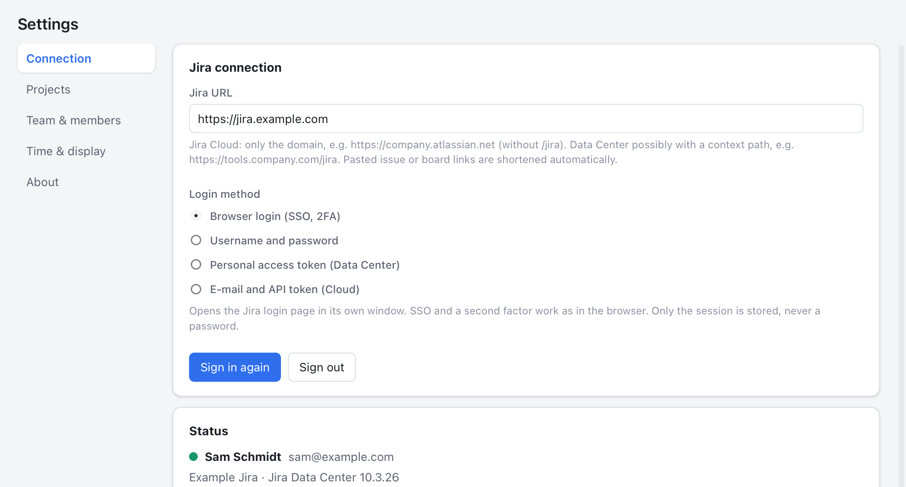
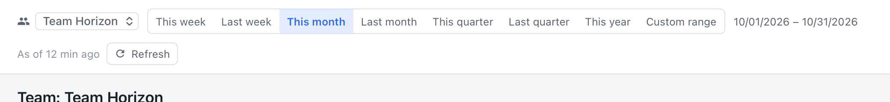
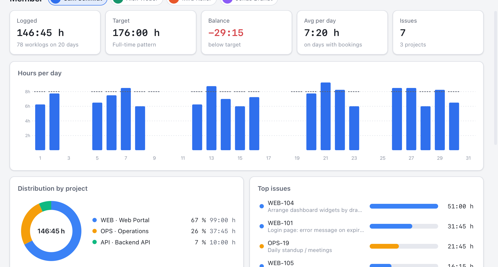
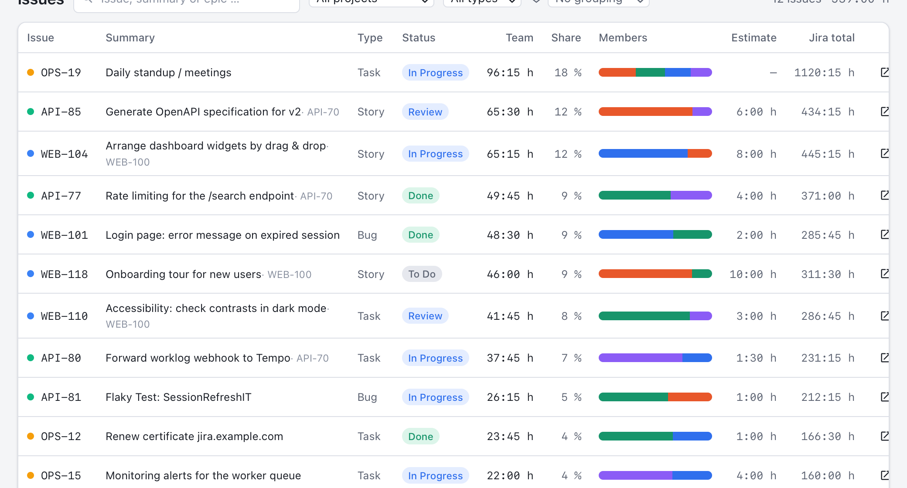

# YaTTAT – Yet another Time Tracking Analysis Tool

Desktop analysis of the time a team logs in Jira, for macOS, Windows and Linux. YaTTAT fetches the
worklogs of your team members from Jira (Cloud and Data Center) or from Tempo Cloud and shows total
hours, hours per issue and statistics per member. It is the counterpart of
[YaTTT](https://github.com/sandschm/YaTTT): YaTTT tracks time, YaTTAT analyses it.

Written in Rust (Tauri 2, business logic in the `yattat-core` crate) with a Svelte user interface.
YaTTAT only reads from Jira and never writes back. The interface is available in English and German.

<p align="center">
  
</p>
<p align="center">
  
  
</p>

<sub>The screenshots show the sample data of the browser mock.</sub>

## Features

- **Team and members** in the settings: search Jira users and assign them to a team, several teams
  possible. Per member optional weekly hours (part-time) and a colour for the charts.
- **Team overview**: logged, target and balance, average per member and day, number of issues;
  hours per member with target marker, hours per day or week stacked by member, distribution by
  project, issue type and weekday, sortable member table with the last worklog.
- **Member**: KPIs and target/actual, trend per day/week, distribution by project, top issues,
  all worklogs by day with comments, export as CSV or JSON.
- **Issues**: time per issue in the range with the share of every member, estimate and Jira total,
  search, filter by project and type, grouping by epic, project or issue type, worklogs per issue,
  jump to the issue in Jira.
- **Range**: this/last week, this/last month, this/last quarter, this year or a custom range.
- **Source of times**: Jira worklogs (default) or **Tempo Cloud** with a Tempo API token. If the
  team logs time in Tempo, Jira often lists the worklogs under the Tempo app account; only the
  Tempo API then reports the real authors. YaTTAT shows after a fetch when Jira attributes worklogs
  to other authors.
- **Source comparison**: reads a range from Jira and from Tempo and compares both per member and
  day, as proof that no times are missing.
- **Local cache**: loaded issues and worklogs live in a SQLite database. YaTTAT remembers per
  member which days are loaded and fetches only the missing ones. "Refresh" reloads the displayed
  range (later bookings and deletions are picked up), optionally automatically at the configured
  interval.
- **Project selection** (optional): restrict the analysis to certain projects.
- Light/dark mode, time format hours:minutes or decimal, week starting Monday or Sunday, language
  English or German (follows the system by default).

## Signing in to Jira (SSO, second factor, no API token)

The default is the **browser login**: the app opens the Jira login page in its own window. SSO
redirects and a second factor work as in the browser. The app then takes over the session; a
password is never stored. Alternatives: username and password (Data Center without SSO), personal
access token (Data Center) or e-mail and API token (Cloud). Details: [docs/JIRA_AUTH.md](docs/JIRA_AUTH.md).

Only worklogs on issues the signed-in person may read in Jira are analysed.

## Installation

Ready-made packages are attached to the [GitHub releases](../../releases): `.dmg` (macOS),
`.msi`/`-setup.exe` (Windows), `.deb`/`.rpm`/`.AppImage` (Linux). Without a code signature macOS
warns on first start: right-click → Open or `xattr -dr com.apple.quarantine /Applications/YaTTAT.app`.

Linux needs WebKitGTK 4.1.

## Quick guide

### 1️⃣ Connect

**Settings → Connection:** enter the Jira URL (Jira Cloud: only `https://company.atlassian.net`),
keep "Browser login", click **Sign in**. In the login window you sign in as usual, with SSO and a
second factor.



Does your team log time in **Tempo**? Then choose "Tempo Cloud" under **Source of times** and enter
a Tempo API token (Tempo → Settings → API integration). The token needs the Tempo permission to see
the members' worklogs.

### 2️⃣ Create a team and add members

**Settings → Team & members:** create or rename a team, then search Jira users and add them with a
click ("Add me" for yourself). Part-time? Enter weekly hours so the target fits. The colour is used
in all charts.


### 3️⃣ Choose the range

Pick team and range in the top bar. Missing days are loaded automatically; the progress is shown on
the right ("Worklogs 12/80"). **As of** names the oldest fetch in the range; if it is older than
twice the refresh interval, "refresh recommended" appears. **Refresh** reloads the range at any time
and picks up later bookings and deletions.



### 4️⃣ Team at a glance

**Team:** logged, target, balance and average per member, hours per member with target marker,
hours per day by member, distribution by project. A click on a member opens their analysis.


### 5️⃣ A single member

**Member:** total hours and target/actual, trend, projects, top issues and all worklogs by day.
Export as CSV (Excel-ready) or JSON.



### 6️⃣ Hours per issue

**Issues:** which issues received the most time in the range, and from whom? The bar shows the
members' shares, next to it estimate and Jira total. Group by epic, project or type; a click on a
row shows the worklogs.



> 💡 **Target hours** come from the full-time weekly pattern (Settings → Time & display, default
> 8 h Mon–Fri) and the member's weekly hours. YaTTAT does not know holidays and vacation; targets
> and balances can be hidden.
>
> 🔁 **Times do not appear?** The range may have been loaded before the times were booked. "Refresh"
> reloads the displayed range; the automatic refresh (default every 30 minutes) does that by itself.
>
> 🧭 **Only some members have times?** If the top bar reports "Worklogs by other authors found",
> Jira lists the times under another account (typically "Tempo Timesheets"). Then choose the source
> **Tempo Cloud** under Settings → Connection. Settings → About shows the details of the last fetch.
>
> ✅ **Want to be sure nothing is missing?** Settings → Connection → **Source comparison** reads the
> displayed range from both sources and shows per member and day where Jira and Tempo differ. Times
> are only lost when a source cannot see them (author, permissions), the project filter excludes
> them or the cache is stale; failed fetches never mark days as loaded.

## Development

Prerequisites: Rust (stable), Node.js 20+, the platform-specific
[Tauri prerequisites](https://tauri.app/start/prerequisites/).

```bash
npm install
```

```bash
npm run tauri dev
```

The interface can also be developed without Tauri in a browser (mock backend with sample data: two
teams, deterministic worklogs for the last 200 days):

```bash
npm run dev
```

In the mock, `?view=team|member|tickets|settings`, `?tab=team` and `?lang=de|en` open a view
directly. The screenshots in `docs/screenshots/` are produced from it with `scripts/screenshots.sh`
(macOS, WebKit snapshot in Retina resolution).

Tests and checks:

```bash
cargo test -p yattat-core
```

```bash
npm run check
```

Release build:

```bash
npm run tauri build
```

## Project structure

```
crates/yattat-core  Business logic without Tauri: Jira client (read-only), Tempo client, SQLite cache, fetch, statistics, export, secrets, i18n
src-tauri           Tauri app: commands, login window, fetch jobs, automatic refresh
src                 Svelte frontend (views, components, store, dictionary, mock backend)
docs                Architecture, Jira access, release
.github/workflows   CI (tests on three platforms) and release (tauri-action)
```

Further documentation: [Architecture](docs/ARCHITECTURE.md), [Jira access](docs/JIRA_AUTH.md),
[Release](docs/RELEASE.md), [Changelog](CHANGELOG.md).

## Data locations

| What | macOS | Windows | Linux |
|---|---|---|---|
| Settings (teams, members), encrypted credentials | `~/Library/Application Support/YaTTAT` | `%APPDATA%\YaTTAT` | `~/.config/YaTTAT` |
| Cache (`yattat-cache.sqlite`), logs | `~/Library/Application Support/YaTTAT` | `%APPDATA%\YaTTAT` | `~/.local/share/YaTTAT` |

The cache only contains what is visible in Jira anyway; "Clear cache" in the settings removes it.

## License

MIT
