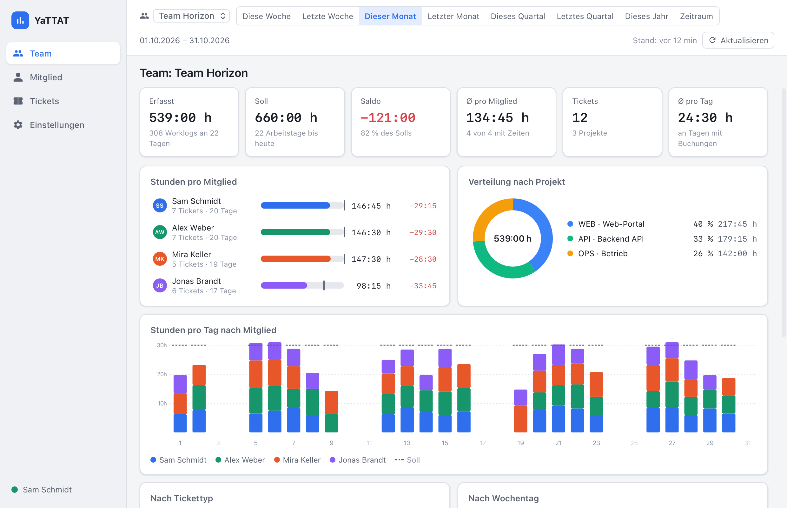
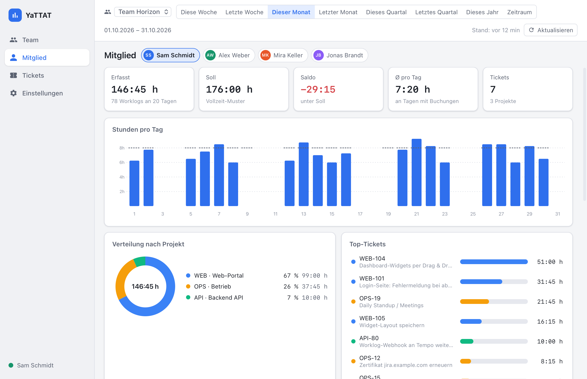
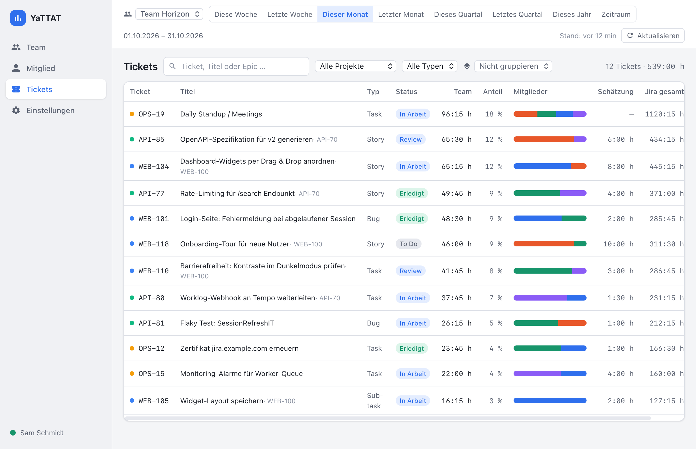
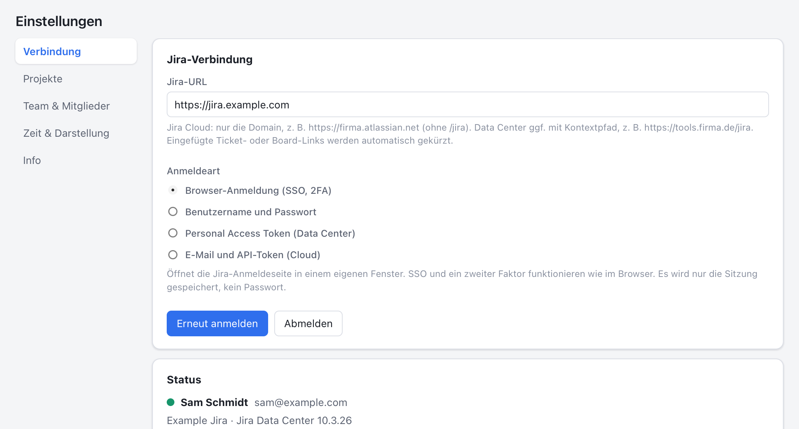
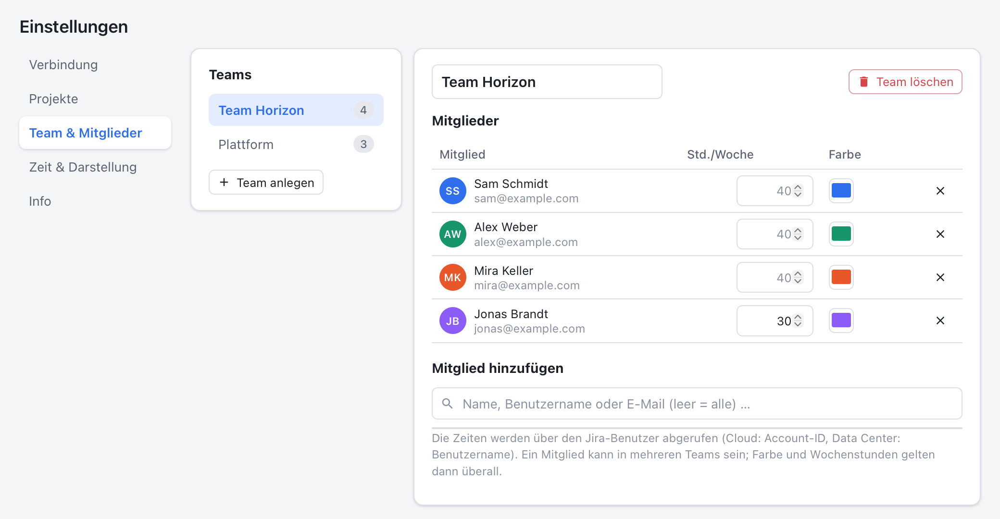
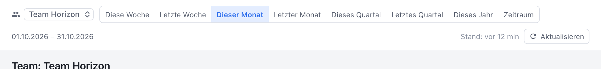
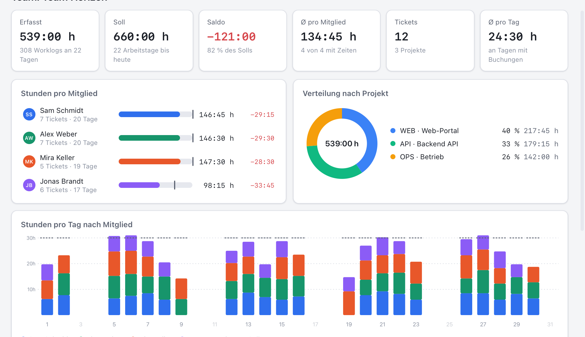
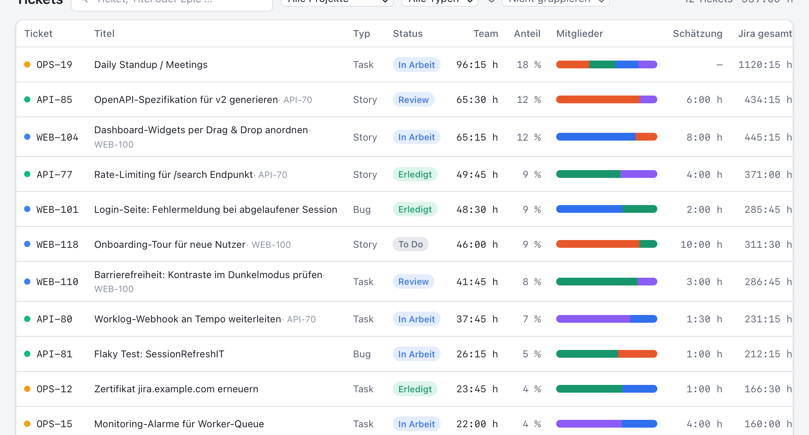

# YaTTAT – Yet another Time Tracking Analysis Tool

Desktop-Auswertung der in Jira gebuchten Zeiten eines Teams für macOS, Windows und Linux. YaTTAT
ruft die Worklogs der Teammitglieder aus Jira ab (Cloud und Data Center) und zeigt Gesamtzeiten,
Zeiten pro Ticket und Statistiken pro Mitglied. Es ist das Gegenstück zu
[YaTTT](https://github.com/sandschm/YaTTT): YaTTT erfasst Zeiten, YaTTAT wertet sie aus.

Geschrieben in Rust (Tauri 2, Fachlogik im Crate `yattat-core`) mit einer Svelte-Oberfläche.
YaTTAT liest nur aus Jira und schreibt nichts zurück.

<p align="center">
  
</p>
<p align="center">
  
  
</p>

<sub>Die Screenshots zeigen die Beispieldaten des Browser-Mocks.</sub>

## Funktionen

- **Team und Mitglieder** in den Einstellungen: Jira-Benutzer suchen und einem Team zuordnen,
  mehrere Teams möglich. Je Mitglied optional Wochenstunden (Teilzeit) und eine Farbe für die Diagramme.
- **Team-Übersicht**: Erfasst, Soll und Saldo, Ø pro Mitglied und Tag, Anzahl Tickets; Stunden pro
  Mitglied mit Soll-Markierung, Stunden pro Tag bzw. Woche gestapelt nach Mitglied, Verteilung nach
  Projekt, Tickettyp und Wochentag, sortierbare Mitgliedertabelle mit letztem Worklog.
- **Mitglied**: Kennzahlen und Soll/Ist, Verlauf pro Tag/Woche, Verteilung nach Projekt,
  Top-Tickets, alle Worklogs nach Tagen mit Kommentaren, Export als CSV oder JSON.
- **Tickets**: Zeit pro Ticket im Zeitraum mit Anteil je Mitglied, Schätzung und Gesamtzeit laut
  Jira, Suche, Filter nach Projekt und Typ, Gruppierung nach Epic, Projekt oder Tickettyp,
  Worklogs je Ticket, Sprung ins Ticket in Jira.
- **Zeitraum**: diese/letzte Woche, dieser/letzter Monat, dieses/letztes Quartal, dieses Jahr oder
  frei wählbar.
- **Lokaler Cache**: Geladene Tickets und Worklogs liegen in einer SQLite-Datenbank. YaTTAT merkt
  sich je Mitglied, welche Tage geladen sind, und holt nur fehlende Tage nach. „Aktualisieren“ lädt
  den angezeigten Zeitraum neu (nachträgliche Buchungen und Löschungen werden übernommen),
  optional automatisch im eingestellten Intervall.
- **Projektauswahl** (optional): Auswertung auf bestimmte Projekte beschränken.
- Hell-/Dunkelmodus, Zeitformat Stunden:Minuten oder dezimal, Wochenbeginn Montag oder Sonntag.

## Anmeldung bei Jira (SSO, zweiter Faktor, kein API-Token)

Standard ist die **Browser-Anmeldung**: Die App öffnet die Jira-Loginseite in einem eigenen
Fenster. SSO-Weiterleitungen und ein zweiter Faktor funktionieren wie im Browser. Anschließend
übernimmt die App die Sitzung; ein Passwort wird dabei nie gespeichert. Alternativ: Benutzername
und Passwort (Data Center ohne SSO), Personal Access Token (Data Center) oder E-Mail und API-Token
(Cloud). Details: [docs/JIRA_AUTH.md](docs/JIRA_AUTH.md).

Ausgewertet werden nur Worklogs auf Tickets, die die angemeldete Person in Jira lesen darf.

## Installation

Fertige Pakete liegen bei den [GitHub Releases](../../releases): `.dmg` (macOS), `.msi`/`-setup.exe`
(Windows), `.deb`/`.rpm`/`.AppImage` (Linux). Ohne Code-Signatur meldet macOS beim ersten Start
eine Warnung: Rechtsklick → Öffnen oder `xattr -dr com.apple.quarantine /Applications/YaTTAT.app`.

Linux benötigt WebKitGTK 4.1.

## Kurzanleitung

### 1️⃣ Verbinden

**Einstellungen → Verbindung:** Jira-URL eintragen (bei Jira Cloud nur `https://firma.atlassian.net`),
„Browser-Anmeldung“ lassen, **Anmelden**. Im Login-Fenster meldest du dich wie gewohnt an, mit SSO
und zweitem Faktor.



### 2️⃣ Team und Mitglieder anlegen

**Einstellungen → Team & Mitglieder:** Team anlegen oder umbenennen, dann Jira-Benutzer suchen und
per Klick hinzufügen („Mich hinzufügen“ für dich selbst). Teilzeit? Wochenstunden eintragen, damit
das Soll passt. Die Farbe gilt in allen Diagrammen.



### 3️⃣ Zeitraum wählen

In der Kopfzeile Team und Zeitraum wählen. Fehlende Tage werden automatisch aus Jira geladen; der
Fortschritt steht rechts („Worklogs 12/80“). **Aktualisieren** lädt den Zeitraum jederzeit neu.



### 4️⃣ Team im Blick

**Team:** Erfasst, Soll, Saldo und Ø pro Mitglied, Stunden pro Mitglied mit Soll-Markierung, Stunden
pro Tag nach Mitglied, Verteilung nach Projekt. Ein Klick auf ein Mitglied öffnet dessen Auswertung.



### 5️⃣ Einzelnes Mitglied

**Mitglied:** Gesamtzeit und Soll/Ist, Verlauf, Projekte, Top-Tickets und alle Worklogs nach Tagen.
Export als CSV (Excel-tauglich) oder JSON.


### 6️⃣ Zeiten pro Ticket

**Tickets:** Welche Tickets haben im Zeitraum die meiste Zeit bekommen, und von wem? Der Balken
zeigt die Anteile der Mitglieder, daneben Schätzung und Gesamtzeit laut Jira. Gruppieren nach Epic,
Projekt oder Typ; ein Klick auf die Zeile zeigt die Worklogs.



> 💡 **Soll-Stunden** ergeben sich aus dem Vollzeit-Wochenmuster (Einstellungen → Zeit & Darstellung,
> Standard 8 h Mo–Fr) und den Wochenstunden des Mitglieds. Urlaub und Feiertage kennt YaTTAT nicht;
> Soll und Saldo lassen sich ausblenden.
>
> 🔁 **Zeiten erscheinen nicht?** Der Zeitraum wurde vielleicht schon geladen, bevor die Zeiten gebucht
> wurden. „Aktualisieren“ holt den angezeigten Zeitraum neu; die automatische Aktualisierung
> (Standard alle 30 Minuten) macht das von selbst.

## Entwicklung

Voraussetzungen: Rust (stable), Node.js 20+, plattformabhängige
[Tauri-Voraussetzungen](https://tauri.app/start/prerequisites/).

```bash
npm install
```

```bash
npm run tauri dev
```

Die Oberfläche lässt sich auch ohne Tauri im Browser entwickeln (Mock-Backend mit Beispieldaten,
zwei Teams, deterministische Worklogs der letzten 200 Tage):

```bash
npm run dev
```

Im Mock öffnen `?view=team|member|tickets|settings` und `?tab=team` eine Ansicht direkt. Die
Screenshots in `docs/screenshots/` entstehen daraus mit `scripts/screenshots.sh` (macOS,
WebKit-Snapshot in Retina-Auflösung).

Tests und Prüfungen:

```bash
cargo test -p yattat-core
```

```bash
npm run check
```

Release-Build:

```bash
npm run tauri build
```

## Projektstruktur

```
crates/yattat-core  Fachlogik ohne Tauri: Jira-Client (lesend), SQLite-Cache, Abruf, Statistik, Export, Secrets
src-tauri           Tauri-App: Commands, Login-Fenster, Abruf-Jobs, Auto-Aktualisierung
src                 Svelte-Frontend (Views, Komponenten, Store, Mock-Backend)
docs                Architektur, Jira-Zugriff, Release
.github/workflows   CI (Tests auf drei Plattformen) und Release (tauri-action)
```

Weitere Dokumentation: [Architektur](docs/ARCHITECTURE.md), [Jira-Zugriff](docs/JIRA_AUTH.md),
[Release](docs/RELEASE.md), [Änderungen](CHANGELOG.md).

## Datenablage

| Was | macOS | Windows | Linux |
|---|---|---|---|
| Einstellungen (Teams, Mitglieder), verschlüsselte Zugangsdaten | `~/Library/Application Support/YaTTAT` | `%APPDATA%\YaTTAT` | `~/.config/YaTTAT` |
| Cache (`yattat-cache.sqlite`), Logs | `~/Library/Application Support/YaTTAT` | `%APPDATA%\YaTTAT` | `~/.local/share/YaTTAT` |

Der Cache enthält nur, was auch in Jira sichtbar ist; „Cache leeren“ in den Einstellungen entfernt ihn.

## Lizenz

MIT
